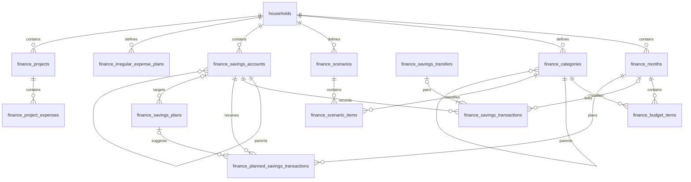

# Home Budget → Family Hub: schema and implementation plan

Prepared: 2026-10-10. Status: phase-one contracts and phase-two schema,
integrity, grants, RLS, and pgTAP source are implemented but have not yet been
applied to a local database. Phase 3 is in progress: atomic, idempotent savings
transfer creation/deletion and their frontend flow are implemented; the other
savings mutations, summaries, and export contracts remain ahead. Amounts are
stored as bounded bigint minor units. No finance data has been changed.

## Recommended outcome

Add a Finance area inside Family Hub, using its existing React Router,
React Query, Supabase Auth, Postgres, and household membership model.
Replace Home Budget's whole-state persistence with relational tables and
explicit mutations. Keep the monthly budget, scenarios, and spending projects
shared within a household. Savings accounts can be shared or private, as
requested by the user. Private account balances, history, goals, and associated
savings plans must be visible only to their owner.

Use a one-time JSON export/import as the initial migration path. It works even
when the two apps use different Supabase projects or different Auth user IDs.
Do not introduce continuous synchronization between the apps.

## 1. Findings from the current applications

### Home Budget

The user's recollection is correct. `src/storage/supabaseSync.ts` reads and
upserts `public.budget_app_states` by `user_id`. The documented row contains
`user_id uuid primary key`, `data jsonb`, and `updated_at timestamptz`.
Every saved edit replaces the application snapshot after a 700 ms debounce.
This includes the selected month, so even navigation can write the snapshot.

`src/storage/budgetStore.ts` also persists the complete state to the browser
key `home-budget-app:v2`. On first cloud use, if no user row exists, the current
local snapshot is uploaded. The local key is not scoped to the signed-in user.
The README describes a local fallback; the current `App.tsx` still presents
the auth screen when Supabase is unconfigured. Migration should use an explicit
export or verified source row, rather than assuming a standalone local mode.

`src/storage/types.ts` defines these collections:

| Source data | Actual functionality |
| --- | --- |
| `months`, `budgetItems`, `categories` | Monthly budget; add/edit/delete rows; zero-row filtering; recurring rows copied to the next month |
| `savingsAccounts`, `savingsTransactions` | Opening balances; deposits/withdrawals; transfers; editable ordinary transactions; monthly savings inclusion |
| Account `parentId`, `targetAmount`, `isArchived` | Account/goal hierarchy; tree balances; goal progress; archive/restore |
| `plannedSavingsTransactions` | Monthly deposit drafts; preview balances; accept drafts into actual transactions |
| `savingsPlans`, `irregularExpensePlans` | Ideal monthly allocations and annual irregular-expense reserves |
| `scenarios[].items` | Scenario comparison and creating a real month from a scenario |
| `projects`, `projectExpenses` | Larger spending projects, targets, and their expense lists |
| `selectedMonthId` | UI preference, rather than a household financial fact |

Important qualifications:

- Scenario and reserve-plan pages primarily display imported/seeded definitions;
  they do not currently offer full definition CRUD. Category editing is also not
  a current UI feature. Building those editors is an optional extension.
- Planned savings acceptance changes savings balances but does not create or
  modify budget items. Project expenses do not automatically modify budget
  items either. The migration must not infer links from matching names/amounts.
- `isPlanned` is preserved in the source model, but monthly calculations sum all
  budget rows without filtering it. It is not an implemented actual-versus-plan
  accounting system.
- Transfers are two signed transactions with one `transferId`, reciprocal
  `transferPeerAccountId` values, and `excludedFromMonthlySavings = true`.
  Deleting either leg removes both; the UI disallows editing a transfer leg.
- The source store has a recursive account-deletion operation, but current pages
  do not call it. It also removes the other leg of transfers touching deleted
  accounts, which changes the surviving account's balance. Prefer archive/restore
  and restrict destructive account deletion in the new app.
- An archived ancestor makes its descendants inactive. Account totals sum each
  account's own balance once; a tree display adds descendant balances.
- Monthly savings history groups by transaction date and counts only positive,
  non-excluded transactions. It includes qualifying history from archived
  accounts; active account balance cards exclude archived trees.
- Editing a displayed goal/tree balance recalculates the account's opening
  balance after subtracting its transactions and active child balances.
- Personal allowances are budget lines with `allocation_role = 'personal_allowance'`
  and a saving category. They reduce income available for the month and are excluded
  from savings and the savings-rate numerator. Treat the role as explicit finance
  data; new flows should not infer it from a line's label.
- `loadIdealPlan` matches plans to accounts by fuzzy name matching. Replace this
  with explicit links, using name matching only as a migration suggestion.
- Legacy IDs are arbitrary strings, including `2026-05`, `emergency-fund`, and
  generated slugs. Do not cast them to UUIDs.
- The source Zod parser checks shapes but not reference integrity or valid dates,
  amount precision, hierarchy cycles, or transfer pairing. It supplies seeded
  savings/reserve plans if older snapshots omit them. An importer must explicitly
  report missing collections rather than silently inserting demo finance data.

### Family Hub

Family Hub already has the target infrastructure:

- `households` and `profiles`; each profile has one `household_id`.
- `private.is_household_member(uuid)` as the existing membership check.
- Household RLS, restricted column grants, and server validation triggers.
- Calendar's shared/private access rules and creator-controlled visibility.
- Feature-specific Supabase adapters, React Query, and React Router.
- SQL migrations in `supabase/migrations/` and pgTAP in `supabase/tests/`.
- Node frontend regression tests and a PWA shell. Offline data writes are not
  currently implemented.

There are no finance tables or routes in the checked-in Family Hub code.
The local Supabase config specifies Postgres 17. This review did not inspect
deployed schemas, Auth users, or production financial snapshots.

## 2. Ownership and privacy contract

The shared budget is household data. A private savings account is household
scoped for tenancy, but only its owner may read or change it. A member
must still belong to that household to access their private account.

| Data | Read/change rights |
| --- | --- |
| Months, budget items, categories, scenarios, projects, project expenses, irregular-expense reserves | Household members |
| Shared savings account and its transactions/drafts | Household members |
| Private savings account and its transactions/drafts | Account owner only |
| Savings plan bound to an account | Same audience as that account |
| Unbound savings plan | Its own declared household/private audience |
| Import receipt and detailed validation report | Importing member only |
| Selected month and display filters | Per user/device UI state |

Proposed first-release boundaries:

1. Account trees have one visibility scope and one designated owner. A private tree's
   descendants belong to the same owner. A shared tree cannot contain a private
   child. Keep privacy fields on each account for efficient RLS, with triggers
   and an atomic subtree update enforcing consistency.
2. Transfers connect two shared accounts or two private accounts owned by the
   same user. Reject mixed private/shared transfers and transfers between two
   owners' private accounts. A shared transfer history would otherwise disclose
   details of a private account. Mixed-scope accounting needs a separate design.
3. Only the designated owner may change an account tree's visibility. The action affects
   existing history, goals, drafts, and linked plans, and must clearly explain
   that consequence. Restrict a visibility change if any existing transfer
   connects outside the subtree; report the dependency instead of silently
   exposing data or making transfer history inconsistent.
4. Household savings cards aggregate shared accounts only. Offer a separately
   labeled personal view for the viewer's private accounts. Do not mix private
   balances into a household total, chart, reserve total, or Today widget.
5. Budget rows are shared, including allowance amounts. A shared row naming a
   personal goal is still shared information; an account being private does not
   hide text already entered in the budget. Do not automatically link shared
   budget rows/projects to private accounts or copy their labels into shared UI.
6. Account creation defaults to private. During legacy import, accounts default
   to private to the importer until the preview explicitly marks them shared.
   Import cannot assign a private account to an arbitrary other member.

This scope preserves the current shared-budget features while adding private
accounts. Private spending projects, private budget months, and bank integrations
are separate future features.

## 3. Proposed relational schema

Use the `finance_` prefix in `public` for the browser-facing domain tables.
Keep migration metadata and internal mutation receipts in `private`.
The proposal has **13 domain tables**, plus **3 internal support tables**.
No separate family/household table or generic JSON state table is needed.

### Common conventions

- Domain rows: `id uuid primary key default gen_random_uuid()`,
  `household_id uuid not null`, `created_by uuid not null`,
  `created_at timestamptz not null`, `updated_at timestamptz not null`,
  `version bigint not null default 1`.
- Reference household to `households`; reference creator to `auth.users`.
  Make identity/household/creator/creation time immutable after insertion.
  The database controls update time and increments versions.
- Persist amounts as bounded signed `bigint` minor units across every finance
  table: PLN 100.23 is stored as 10023. The database domain caps values at
  +/-999999999999999999 minor units. PostgREST serializes bigint columns as
  JSON numbers by default, so row reads must explicitly cast every amount
  column to `text` (for example, `amount::text`) before JSON serialization.
  Keep those values as integer strings in row contracts; convert decimal input
  strings to/from minor units with `BigInt`. UI calculations and summaries may
  use decimal strings, but arithmetic must remain exact and reject non-finite
  inputs or values outside the bound.
- First release uses PLN, matching the source. Avoid adding exchange-rate or
  multicurrency accounting to this migration.
- Calendar dates use `date`; audit timestamps use `timestamptz`. Derive local
  transaction dates deliberately instead of slicing a UTC timestamp near midnight.
- Add `unique (household_id, id)` to referenced domain tables. Child relations
  use composite FKs `(household_id, parent_id)` so a reference cannot cross
  households even when a privileged caller bypasses RLS.
- Blank names, invalid classifications, self-parenting, and cycles are invalid.
  Hierarchy/transfer checks need triggers or mutation functions; a normal FK
  alone cannot enforce those relationships.
- Preserve signed legacy amounts in budget/scenario/project rows for parity,
  including refunds/adjustments. Positive target amounts are required when set.
  Zero ordinary budget rows remain valid. Transfer amount must be positive.

### Monthly budget and scenarios: five tables

| Table | Additional columns | Constraints / purpose |
| --- | --- | --- |
| `finance_months` | `month_start date`, `display_name text null` | First day of month; unique `(household_id, month_start)`. Derive year/month/localized label; preserve a legacy custom label when necessary. |
| `finance_categories` | `name text`, `budget_type text`, `parent_id uuid null`, `color text null`, `sort_order integer` | `budget_type` is `income`, `fixed_expense`, `variable_expense`, `saving`, or `investment`. Parent must have the same type; prevent cycles. |
| `finance_budget_items` | `month_id uuid`, `category_id uuid`, `name text`, `amount bigint (minor units)`, `allocation_role text`, `is_planned boolean`, `is_recurring boolean`, `notes text null`, `sort_order integer` | Role `standard` or `personal_allowance`; allowance requires a saving category. Month/category composite FKs. |
| `finance_scenarios` | `name text`, `description text null`, `sort_order integer` | Scenario definition; separate from real months. |
| `finance_scenario_items` | `scenario_id uuid`, `category_id uuid`, `name text`, `amount bigint (minor units)`, `allocation_role text`, `is_planned boolean`, `is_recurring boolean`, `notes text null`, `sort_order integer` | Same line semantics as budget items; scenario/category composite FKs. |

For normalization, store the most specific category on each item. If the source
has `subcategoryId`, use it after proving it belongs under `categoryId`.
Do not store both the root and leaf category. Derive the item's five-way budget
type from its category; do not repeat that type on every item.
Treat category budget type as immutable once referenced, and disallow moving a
referenced category between roots in the first release. This avoids rewriting
historical classifications. Names/colors can still change.

`allocation_role` is an independent classification, not another category type.
It replaces the legacy label-based allowance classification. Translate the
source classification into this explicit role during import, then expose the
role as a form field. In the new app, changing an item's label must not change
its effect on income or savings rate.

### Savings: six tables

| Table | Additional columns | Constraints / purpose |
| --- | --- | --- |
| `finance_savings_accounts` | `name text`, `account_type text`, `parent_id uuid null`, `opening_balance bigint (minor units)`, `target_amount bigint (minor units) null`, `color text null`, `is_archived boolean`, `visibility text`, `owner_user_id uuid`, `sort_order integer` | Type `cash`, `goal`, `investment`, `retirement`; visibility `household`/`private`. Owner controls sharing. Parent composite FK; tree privacy/owner consistency and no cycles. |
| `finance_savings_transfers` | No extra financial values; common identity/audit columns group two transaction legs | Transfer header gives paired legs one lifecycle. Derive endpoints, amount, and date from legs instead of duplicating them here. Access requires both legs to be accessible. |
| `finance_savings_transactions` | `account_id uuid`, `transaction_date date`, `amount bigint (minor units)`, `description text null`, `budget_month_id uuid null`, `excluded_from_monthly_savings boolean`, `transfer_id uuid null`, `source_planned_transaction_id uuid null` | Signed delta; account/month/transfer composite FKs. Unique non-null `source_planned_transaction_id` prevents posting a draft twice. Ordinary zero deltas allowed for legacy parity. |
| `finance_planned_savings_transactions` | `month_id uuid`, `account_id uuid`, `amount bigint (minor units)`, `description text null`, `source_savings_plan_id uuid null` | Unposted drafts only. Composite month/account/plan FKs. Optional partial unique `(household_id, month_id, account_id, source_savings_plan_id)` for plan-generated drafts. |
| `finance_savings_plans` | `name text`, `plan_type text`, `account_id uuid null`, `monthly_amount bigint (minor units)`, `annual_amount_override bigint (minor units) null`, `visibility text`, `owner_user_id uuid`, `sort_order integer` | Type also allows `irregular`; explicit account link replaces fuzzy matching. Linked plan must have the account's visibility and owner. Unbound plan starts owned by its creator. |
| `finance_irregular_expense_plans` | `name text`, `annual_amount bigint (minor units)`, `sort_order integer` | Shared annual reserve definitions; monthly requirement is derived as annual amount / 12 using integer arithmetic and an explicit rounding rule. |

`owner_user_id` references `auth.users` and is distinct from audit `created_by`.
The server assigns a new root to the current user and a child/linked plan to the
root/account owner after access checks. This lets another member add a subaccount
to a shared tree without acquiring its sharing rights. Owners must be household
members at creation; ownership reassignment is outside the first release.
Owner fields are immutable and never caller-selected in ordinary create APIs.
If an owner leaves, shared accounts remain available, private accounts become
inaccessible, and recovery/reassignment requires a separately authorized process.
Never automatically share private history when an owner leaves.

`source_planned_transaction_id` is retained provenance, not an FK to a draft:
acceptance removes the draft row. A legacy transaction has null provenance.
Create only one accepted transaction per draft ID. Account-linked plans may
explicitly post into an account but remain separate from shared budget lines.
If an annual savings-plan value equals monthly × 12, derive it; otherwise
preserve the source's explicit annual value as an override.

Transfers must have exactly two legs with distinct accounts, the same date,
equal-and-opposite nonzero amounts, and exclusion from monthly savings.
Enforce this at transaction completion with a deferred constraint trigger.
Use transfer functions for creation/deletion; ordinary transaction editing
cannot modify a transfer leg. Derive the peer account from the other leg,
so `transferPeerAccountId` is not duplicated in the new model.

### Spending projects: two tables

| Table | Additional columns | Constraints / purpose |
| --- | --- | --- |
| `finance_projects` | `name text`, `description text null`, `target_budget bigint (minor units) null`, `is_archived boolean`, `sort_order integer` | Shared spending project; optional target. |
| `finance_project_expenses` | `project_id uuid`, `expense_date date null`, `name text`, `amount bigint (minor units)`, `notes text null`, `sort_order integer` | Composite project FK; preserve absent dates instead of inventing them. |

### Internal migration and mutation tables

| Table | Proposed columns / keys |
| --- | --- |
| `private.finance_import_runs` | `id`, `household_id`, `imported_by`, `source_namespace`, `source_format_version`, `source_sha256`, `mapping_sha256`, `import_mode`, `counts jsonb`, `completed_at`; unique request fingerprint per household/importer/namespace/mode. Hash the payload and privacy/mapping choices separately. |
| `private.finance_legacy_id_map` | `household_id`, `source_namespace`, `entity_type`, `legacy_id text`, `target_id uuid`, `import_run_id`; unique source entity key. Include scenario ID in nested scenario-item keys. |
| `private.finance_operation_receipts` | `household_id`, `actor_id`, `operation_name`, `request_id uuid`, `request_sha256`, `result jsonb`, `completed_at`; unique `(household_id, actor_id, operation_name, request_id)`. Same key/different arguments is a conflict. |

JSON is appropriate for bounded receipts/reports; it is not the authoritative
finance state. Keep these support tables outside the exposed schemas and
without direct browser grants. Return only the caller's receipts via narrowly
scoped functions. Do not store raw budget snapshots in ordinary application logs.

### Relationship overview



The diagram does not show every household/audit FK. Transfer pairs need exactly
two legs; that cardinality requires the constraint trigger described above.

### Indexes and deletion rules

Index every referencing FK used in reads/deletes. In particular:

- Months: unique `(household_id, month_start)`.
- Budget/scenario items: `(household_id, month_id/scenario_id, sort_order, id)`;
  category references separately.
- Accounts: `(household_id, visibility, created_by)`,
  `(household_id, parent_id)`; plans: account reference and visibility lookup.
- Transactions: `(household_id, account_id, transaction_date, id)`,
  `(household_id, transaction_date)`, transfer/month references, and draft
  provenance uniqueness.
- Drafts: `(household_id, month_id, account_id)` and source-plan reference.
- Expenses: `(household_id, project_id, expense_date, id)`.

Use `RESTRICT` for referenced categories and savings accounts; archive accounts
with history. Allow removing an empty account only after checking descendants,
plans, drafts, and transfer dependencies. Deleting a transfer header cascades its
two legs in one transaction. Scenario/project child rows can cascade when their
parent is explicitly deleted. Do not expose month deletion in the first UI;
restrict it when linked actual savings exist. Never use an implicit account
cascade that deletes financial history in another account.

## 4. RLS, grants, and database operations

Shared-table policies use `private.is_household_member(household_id)` for reads
and writes. Inserts require `created_by = auth.uid()`. Updates check both the
old and new row and cannot move data to another household.

Account policies additionally require `visibility = 'household' OR
owner_user_id = auth.uid()`. Transactions and drafts inherit account access;
plans enforce their declared audience and linked-account consistency.
Transfers are visible only when both account legs are accessible. These
conditions apply to direct reads, joins, functions, exports, and summaries.

Use private security-definer predicate helpers where necessary to validate
hidden account references without exposing their details. Fully qualify object
names, set `search_path = ''`, and return generic authorization failures.
Creator/ownership checks remain required inside every privileged mutation.
Restrict function execution explicitly to authenticated callers.

Use direct Supabase reads and simple row mutations for shared budget/project
data. For those updates, require the expected row `version` and return a conflict
if no matching row is updated. Submit saved edits on blur/Save, rather than
turning each input keystroke into a database write.

Savings writes and compound operations go through database functions. Revoke
direct savings-table DML that could bypass pairing, privacy transitions,
idempotency, or locking. Prefer security-invoker functions where caller grants
suffice; use narrowly scoped security-definer functions where the operation
requires privileges intentionally withheld from direct browser access.

| Function contract | Required behavior |
| --- | --- |
| `finance_create_month` | Create an empty month, copy recurring rows, or copy a scenario in one transaction. Unique target month; if it exists, return it without appending copied rows. Copied rows use fresh IDs and `is_planned = false`. |
| `finance_save_account` / `finance_save_transaction` / `finance_save_draft` / removal counterparts | Validate current membership and account access; expected-version update; forbid editing transfer legs; reject posting to archived account trees. |
| `finance_set_account_tree_visibility` | Owner only; update the subtree and linked plans together; refuse transfer dependencies crossing the subtree; do not transfer ownership implicitly. |
| `finance_transfer_savings` / `finance_delete_transfer` | Validate both endpoints and their privacy scope; create or remove exactly two legs atomically. Creation uses a request ID for retry safety. |
| `finance_accept_savings_plan` | Accept only drafts accessible to the caller for the month; lock rows, post each valid nonzero draft once, use the month's first date and linked month, remove only accepted drafts, return created IDs and skipped reasons. |
| `finance_load_savings_plan` | Use explicit accessible plan/account links; skip archived/unmapped/irregular plans; preserve the source's no-extra-plan-for-an-already-planned-account behavior; prevent duplicate generated drafts on retries. |
| `finance_set_account_display_balance` | Lock the account tree; recalculate opening balance from the requested total minus own transactions and active descendants, preserving current UI semantics without a lost-update race. |
| `finance_import_legacy_snapshot` | Validate and import the complete reviewed snapshot and ID map in one transaction; membership/access checks; idempotent receipt. |
| `finance_export_snapshot` | Return a versioned consistent read of shared data plus the caller's private data; never export another member's private accounts or metadata. |
| `finance_restore_snapshot` | Accept the versioned Family Hub export through the same preview/validation/atomic-commit machinery; require an empty authorized target scope; remap IDs and private ownership; preserve explicit allowance roles and plan links. Do not force a current-format backup through the legacy name-based mapping. |

Acceptance intentionally improves two source edge cases: zero and archived
drafts remain pending with a reason, rather than being silently removed; one
member's acceptance never clears another member's private drafts. Display this
behavior in the migration notes and acceptance result.

Acquire a transaction-scoped household finance lock in all savings mutation
functions and import/compound functions, then any needed row locks in consistent
order. This is adequate for a small household and simplifies races between
acceptance, archiving, balance corrections, and privacy changes. Shared finance
table write triggers must acquire the same lock so direct CRUD cannot race an
import or month-copy snapshot. Recheck eligibility after acquiring locks.
Serialization does not replace versions or request IDs: retries must return
the original result without creating a second transfer or a second month.

Derived balances/totals are reads, not persisted mutable facts. Use accessible
transaction rows and account opening balances. For any exposed aggregate views,
use `security_invoker = true`, or an invoker read function, so RLS continues to
apply. Shared summaries explicitly filter to household-visible accounts.

## 5. Migration workflow and mapping

### Recommended initial path

1. Choose one authoritative Home Budget snapshot for the household's shared
   budget. If two users have separate source rows, do not automatically combine
   them: they may contain duplicate months/accounts or conflicting copies.
2. Export JSON from Home Budget's Settings page after verifying sign-in and a
   successful cloud sync. Keep the original file as an immutable backup. Browser
   storage is origin/device specific; Family Hub cannot automatically read the
   old app's localStorage at another origin.
3. Open Family Hub's Finance import page while signed into the target household.
   Identity comes from Family Hub Auth, not an email match or a source user UUID.
4. Validate the payload and show a dry-run: collection counts, month range,
   reference/date/amount errors, allowance classification, transfer pairing,
   account-tree privacy choices, and plan-to-account mapping suggestions.
5. Show that budget/scenario/project/reserve records are shared. Default savings
   trees to private to the importer; require an explicit choice to share them.
   Linked plans follow their account. Unbound plans require a privacy choice too.
6. Commit the reviewed payload and mapping via one transactional RPC. The
   server repeats validation; a client-only dry-run is not a trust boundary.
7. Compare imported counts and money summaries to the source. In the importer
   view, shared + own-private figures reconcile to the source. Shared-only
   figures reconcile to the reviewed shared subset. Verify isolation while
   signed in as another member and a member of another household.
8. Stop editing Home Budget during final export/import/cutover. Family Hub
   becomes the finance source of truth. Keep the old row and exported backup
   until the new app's finance flows and export/restore have been verified.

The initial full import requires an empty shared finance domain and no finance
accounts/plans already owned by the importer. Check that condition server-side
under the finance lock. Another member's unrelated private accounts do not
need to block it or be exposed. An identical committed request returns its
receipt before the emptiness check; a changed snapshot after completion is
rejected with a generic conflict, never silently merged or used to replace data.

A later member can use a separate **private-accounts-only import**: skip shared
months/items/scenarios/projects/reserves, import only reviewed private accounts,
transactions, drafts, and associated plans owned by that member. Existing linked
months must be explicitly mapped by date, and missing months/draft dependencies
must be resolved or omitted in the preview. Never create shared rows implicitly
through this mode. Automatic multi-user merging is outside the first release.

### Mapping rules

| Legacy field | Target treatment |
| --- | --- |
| String IDs | Allocate UUIDs and retain a source/entity-qualified ID map. Do not assume a string is a globally unique UUID. |
| `months[].year/month/name` | Validate consistency; construct `month_start`; preserve label if necessary. Reject duplicate calendar months in one household snapshot. |
| `selectedMonthId` | Restore the importing user's UI selection if valid; no shared selected-month column. |
| `BudgetItem.type`, category type | Map camelCase names to snake_case category types; validate agreement before dropping repeated item type. |
| `categoryId`, `subcategoryId` | Validate both references/type/ancestry; persist the leaf. Report inconsistent records for explicit repair. |
| Legacy saving rows representing a household member's personal spending allocation | Import with `allocation_role = 'personal_allowance'`; preserve the category and original label. This role is independent from savings-account transfer pairs. |
| `parentId` | Remap after allocating all IDs; detect dangling parents, self-links, and cycles; enforce privacy consistently per tree. |
| `initialBalance` | Convert exactly to integer minor units in `opening_balance`; do not create another opening transaction that would count it twice. |
| Signed transaction amount / date | Convert signed money exactly to integer minor units; require a valid date; remap the optional linked month. Monthly savings grouping still follows date. |
| `transferId`, `transferPeerAccountId` | Validate exactly two reciprocal, equal/opposite legs; create one header and two remapped movements; derive peers thereafter. Broken pairs block import. |
| `excludedFromMonthlySavings`, `isArchived`, project `archived` | Preserve flags; absent optional booleans become false. Valid transfer legs must be excluded. |
| Planned savings rows | Import unposted drafts; no new actual transactions. |
| Savings plan names | Suggest links using legacy normalization; require review for ambiguous/unmatched names; use FKs thereafter. |
| Savings-plan annual amount | Derive monthly × 12 when equivalent; preserve a differing explicit value as `annual_amount_override`. |
| Missing optional collections | Use empty collections and report the missing fields; offer deliberate setup separately. Do not silently inject source demo data. |
| Source timestamps and array order | Preserve existing valid source timestamps where available through the importer; use import time for missing audit dates; retain array order in `sort_order`. |

Preflight also checks that decimal input money is finite, has at most two
decimal places, and converts exactly to a bounded integer minor-unit amount;
it also checks target constraints, duplicate entity IDs, unknown
classification values, blank labels, and every reference. Fail the whole import
with paths such as
`savingsTransactions[4].accountId`; no quiet dropping of malformed rows.

For initial household-private assignment, source snapshots contain no account
owners. Family Hub must not infer an owner from a person's name. The importer
owns private trees; another member imports their own data separately.

An optional later cloud-to-cloud importer can read the source user's row using
separate source-project authentication or an authorized server tool. Verify
whether the Supabase project and Auth identity actually match first. Keep any
privileged credentials server-side; reuse the same validated mapping/commit path.
It is unnecessary for the initial JSON workflow.

## 6. Frontend integration

Add one **Finanse** navigation entry and nested routes, avoiding a second app
shell and a second sign-in flow:

| Route | Source equivalent |
| --- | --- |
| `/finance` | Monthly financial dashboard |
| `/finance/budget` | Budget lines, month selector, recurring copy |
| `/finance/savings/accounts` | Shared/private account balances and transaction history |
| `/finance/savings/goals` | Goals, subaccounts, archive/restore, balance adjustment |
| `/finance/savings/planner` | Draft deposits, load ideal plan, preview and accept |
| `/finance/savings/reserves` | Ideal plans and irregular reserves with audience-aware totals |
| `/finance/forecast` | Scenario comparison and create month |
| `/finance/projects` | Larger spending projects and expenses |
| `/finance/settings` | Import, accessible-data export, finance settings |

Suggested module structure:

```text
frontend/src/finance/
  types.ts                       persisted minor-unit and UI decimal money contracts
  money.ts                       exact conversion, arithmetic, and PLN formatting
  calculations.ts                tested summaries and account-tree calculations
  api/                           budget, savings, scenarios, projects, import adapters
  queries.ts                     keys, hooks, invalidation rules
  FinanceLayout.tsx              nested navigation and per-user month selection
  budget/, savings/, forecast/, projects/, settings/, dashboard/
  migration/                     source validation, mapping, dry-run UI
```

Port pure calculations and meaningful UI behavior. Replace `useBudgetStore`
calls with query/mutation hooks; do not copy the source Zustand store, snapshot
sync effect, auth page, global styles, or manual `window.history` router.
Use Family Hub's styles and responsive components. Add Recharts only for chart
parity if desired; Zustand is not required for the new persistence model.

Query keys include `['finance', householdId, userId, ...]` for all finance
queries, including ostensibly shared ones that compose private data. Include
month/range/audience where applicable. Cancel and remove the `finance` query
prefix on sign-out/account switch in `AuthGate`; it currently clears selected
calendar prefixes only. Reset local draft inputs and selection on identity
change. Scope persisted UI preferences by household and user.

Show explicit `Household` / `Private` labels on account selectors and summaries.
Keep household and personal figures separate, and avoid leaking private names
through search suggestions, validation messages, shared charts, or export reports.
Financial amounts are never placed in service-worker caches or localStorage.
The first release follows Family Hub's online-data behavior; show save failures
and retain unsaved form input until the user retries.

Invalidate only affected query groups after a successful mutation: a transfer
affects both accounts and relevant history/balances; acceptance affects drafts,
transactions, balances, and monthly savings; it does not change budget totals.
Visibility changes require fresh reads for all affected savings queries. Start
with refetch on navigation/window focus; do not introduce Realtime subscriptions
or an offline mutation queue until those are explicitly needed.

First-use setup creates an empty month/categories or imports a snapshot. Do not
automatically populate real household data with the source seed state. Keep
demo/reset functions confined to a clearly separate demo environment.

## 7. Implementation sequence and completion checks

| Phase | Deliverables | Completion condition |
| --- | --- | --- |
| 1. Freeze behavior and contracts | Source-derived fixtures, money representation, privacy rules, row/API types, schema review | Monthly summary, account/tree balance, date grouping, archive inheritance, allowances, and standalone project semantics have parity expectations. Intended acceptance/privacy changes are documented. |
| 2. Database foundation | New migrations for the 13 domain tables, internal tables, composite FKs, indexes, triggers, grants, RLS | Fresh local DB applies all migrations; same-household shared access and private isolation pass pgTAP, including direct REST-style access. |
| 3. Mutation/read contracts | Savings and compound RPCs; optimistic versions; idempotent receipts; summaries/export | Transfer, acceptance, copy month, archive/balance correction, and sharing transitions are atomic; unauthorized calls fail; retry/concurrency checks pass. **Progress:** transfer RPCs, the transfer screen, and database/frontend verification source are added; the phase remains open. |
| 4. Importer | Validator, ID mapping, preview/privacy choices, atomic import, reconciliation receipt | Representative snapshots import with matching counts/totals; bad references or transfer pairs cause no writes; identical retry does not duplicate rows. |
| 5. Budget vertical slice | Finance layout/routes, month setup, dashboard, budget editing and recurring copy | Household members can use a fresh shared budget and an imported budget; stale edit shows a conflict; empty state works. |
| 6. Savings vertical slice | Account/goal trees, privacy labels, transactions, transfers, drafts, plans/reserves, archive/restore | Owner sees own private accounts; another member sees only shared accounts; shared and personal totals reconcile; drafts post exactly once. |
| 7. Remaining parity | Scenarios, project expense pages, accessible export/restore | Scenario creates a correct new month; project totals stay separate; export/restore round-trip includes all accessible finance entities. |
| 8. Household cutover | Staging rehearsal, final export, import/reconciliation, desktop/mobile review, target deployment | Two members complete end-to-end flows; outsider cannot read data; final authoritative snapshot reconciles; old app is retained read-only for rollback. |

Start with phases 1–4 before importing any real data. The first useful product
milestone is shared monthly budget + private/shared savings + reliable import;
complete phases 5–7 to claim full feature migration. Do not cut over while
imported scenarios/projects/plans still lack usable pages or exports.

Suggested migration files, with new unique timestamps allocated at implementation:

```text
supabase/migrations/<timestamp>_create_finance_schema.sql
supabase/migrations/<timestamp>_secure_finance_access.sql
supabase/migrations/<timestamp>_add_finance_operations.sql
supabase/migrations/<timestamp>_add_finance_import_export.sql
supabase/tests/finance_rls.test.sql
supabase/tests/finance_operations.test.sql
supabase/tests/finance_import.test.sql
frontend/tests/finance.test.mjs
frontend/tests/finance-import.test.mjs
```

## 8. Verification and rollout

Meaningful automated coverage:

- Three-user privacy fixtures: owner, second household member, outsider;
  anonymous access; shared edits; private reads/edits; forged creator/household;
  cross-household references; plans/drafts/transfer/export/aggregate access.
- Private-data absence in shared totals and another member's exports, including
  names, counts, IDs, balances, and transfer peer details. A user who leaves
  the household loses access even to their former private accounts.
- Money parsing for decimal comma/dot, signed values, precision rejection,
  non-finite inputs, large-value bounds, exact totals, and bigint-safe integer
  strings at persisted row boundaries.
- Account hierarchy cycles, inherited archive state, distinct own/tree totals,
  visibility propagation, external-transfer blockers, and balance corrections.
- Two-leg transfer invariant, no partial writes, deletion of both legs, and
  retry with the same request ID. Verify a transfer cannot inflate monthly saving.
- Two concurrent acceptance requests cannot post one draft twice; later replay
  does not accept newly added drafts. Archived/zero/inaccessible drafts remain
  untouched; a concurrent draft edit either wins before acceptance or conflicts.
- Next-month copy includes recurring rows only, preserves category/allowance,
  resets `is_planned`, handles December, and never appends to an existing month.
- Legacy mapping of arbitrary IDs/nested scenarios, missing collections, bad
  dates/references, mixed precision, damaged transfer pairs, and ambiguous plans.
- Reconciliation of allowances, source balances, archive-sensitive totals,
  monthly deposits by date, project totals, scenario totals, and reserve totals.
- Account-switch cache removal and stale mutation responses; safe form handling
  on failures. Bounded/paginated transaction lists rather than default API row
  limits silently truncating history or totals.
- Versioned export/restore into an empty target, consistent-read export, and
  source audit/order preservation. Restore does not honor another user's private
  ownership fields and remaps owners to the authorized importing user; current
  audit `created_by` records the importer while source provenance stays internal.

Run existing Family Hub frontend tests/build and local database tests, plus the
new suites. Test concurrency with two real database sessions, not only sequential
pgTAP statements. No server execution is needed for the planning stage.

Manual release checks: two household sessions and an outsider; phone/desktop
layouts; private-to-shared warning/history effect; failure/retry during import;
export after migration; installed PWA navigation; household/member account
switching; and the unchanged Tasks/Shopping/Calendar flows.

Back up the target before import. Keep the immutable source export and import
receipt. If rehearsal fails before any new Family Hub writes, discard only the
new rehearsal dataset in its isolated environment. After new live writes, do
not overwrite the target with the old source blob or resume concurrent use of
both apps; first export the new state and reconcile changes for recovery.
Deploy schema/functions before enabling finance routes in each environment.

## 9. Decisions still relevant at implementation

The user has selected a shared budget with some private accounts. This plan
proposes creator-owned private account trees, account creation/import defaulting
to private, shared-only household totals, and same-scope transfers. The import
preview lets the user decide exactly which source accounts to share.

Implementation must establish which source snapshot is authoritative, whether
the apps use the same Supabase project, and the target household. These do not
block the proposed JSON workflow or require guessing source Auth identities.

Keep full category/scenario/reserve editors, automatic source-row merging,
mixed-scope transfers, private spending projects, bank connections, multicurrency,
offline writes, and continuous synchronization outside the first migration.

## Source references

Repository findings:

- Home Budget: `src/storage/types.ts`, `budgetStore.ts`, `supabaseSync.ts`,
  `seedData.ts`, `src/shared/utils/budgetCalculations.ts`, `money.ts`,
  `src/app/App.tsx`, feature pages, and `README.md`.
- Family Hub: `frontend/src/App.tsx`, `layout/AppShell.tsx`, `auth/AuthGate.tsx`,
  `tasks/api.ts`, `calendar/queries.ts`, shopping/task/calendar SQL migrations,
  `supabase/tests/rls.test.sql`, `supabase/config.toml`, `IMPLEMENTATION_PLAN.md`,
  and `README.md`.

Technical references checked for the proposed database approach:

- Integer storage and bounds: [PostgreSQL integer types](https://www.postgresql.org/docs/current/datatype-numeric.html#DATATYPE-INT).
- Bigint-safe row responses: [PostgREST column casting](https://docs.postgrest.org/en/stable/references/api/tables_views.html#casting-columns); cast amount columns to `text` in row projections.
- Composite keys, referential constraints, and deletion policies: [PostgreSQL constraints](https://www.postgresql.org/docs/current/ddl-constraints.html).
- Database RPCs, rollback on errors, invoker/definer privileges, and restricted execution: [Supabase database functions](https://supabase.com/docs/guides/database/functions).
- Row-level isolation and invoker views: [Supabase RLS](https://supabase.com/docs/guides/database/postgres/row-level-security).

The concrete schema, privacy boundaries, mutation contracts, and rollout sequence
above are design recommendations derived from the two applications, rather than
claims that this implementation already exists.
